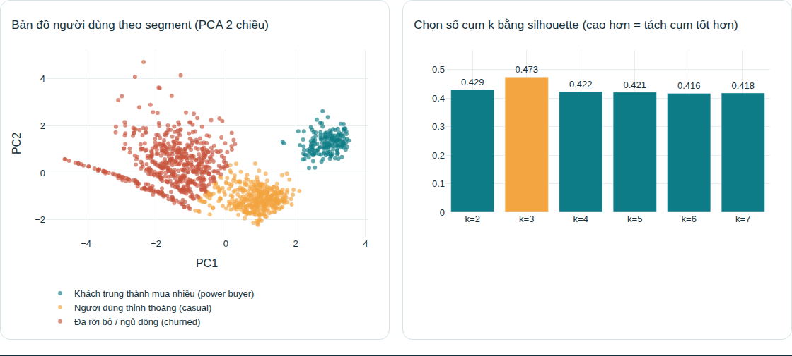

# Product Analytics + AI tóm tắt hành vi người dùng

Đồ án môn Lập trình Python — phần **Segmentation**, **Journey analysis** và **cảnh báo engagement giảm bất thường**.



| Xem | Link |
|---|---|
| Trang web kết quả (biểu đồ tương tác) | `https://<user>.github.io/<repo>/` |
| App chạy trực tiếp, chỉnh tham số | `https://<app>.streamlit.app` |

> Thay `<user>`, `<repo>`, `<app>` bằng thông tin thật sau khi đăng lên (xem phần *Đăng lên GitHub*).

## Làm được gì

| Phần | Kỹ thuật | File |
|---|---|---|
| Thu thập + validation | Event schema, loại event sai/trùng/timestamp lỗi | `config.py`, `validation.py` |
| Segmentation | RFM + hành vi → chuẩn hoá → K-Means, chọn k bằng silhouette | `segmentation.py` |
| Journey | Session hoá, top path, ma trận chuyển bước (Markov), funnel, funnel theo segment | `journey.py` |
| Cảnh báo | Baseline cùng thứ + robust z-score (median/MAD) + cooldown, theo toàn hệ thống và theo platform | `alerting.py` |
| AI tóm tắt | Gom số liệu thật thành JSON rồi gọi Claude; không có API key thì dùng template offline | `ai_summary.py` |
| Trực quan | Plotly (web tĩnh + Streamlit) | `viz.py`, `app.py`, `build_site.py` |

Dữ liệu là **giả lập có chủ đích**: 4 nhóm hành vi ẩn và một sự cố làm Android giảm hoạt động ở cuối kỳ, để kiểm chứng thuật toán tìm lại được.

## Chạy trên máy

```bash
git clone https://github.com/<user>/<repo>.git
cd <repo>
pip install -r requirements.txt

streamlit run app.py     # giao diện trực quan, chỉnh tham số, tải CSV của bạn lên
python main.py           # chạy dòng lệnh, in kết quả, lưu output/dashboard.png
```

Dùng dữ liệu của bạn: tải file CSV lên trong app, cột bắt buộc `event_id, user_id, event_name, timestamp, platform`.
`event_name` hợp lệ nằm trong `config.py` (`EVENT_SCHEMA`), sửa cho khớp sản phẩm của bạn.

**AI thật (tuỳ chọn):** đặt biến môi trường `ANTHROPIC_API_KEY` rồi chạy lại. Không đặt thì app tự dùng bản template offline.

## Vẽ lại sơ đồ

```bash
# cần cài Graphviz hệ thống: https://graphviz.org/download/
python diagrams.py       # -> docs/assets/flow.png, architecture.png, erd.png
```

## Đăng lên GitHub

**1. Đẩy code**
```bash
git remote add origin https://github.com/<user>/<repo>.git
git push -u origin main
```

**2. Bật trang web (GitHub Pages)** — Settings → Pages → *Build and deployment* → Source: **Deploy from a branch** → Branch: `main`, thư mục `/docs` → Save. Sau 1–2 phút trang có tại `https://<user>.github.io/<repo>/`.

**3. Deploy app chạy trực tiếp (Streamlit Community Cloud, miễn phí)** — vào https://share.streamlit.io → *New app* → chọn repo, branch `main`, Main file path `app.py` → Deploy.

**4. Gắn link vào trang web**
```bash
python build_site.py --repo https://github.com/<user>/<repo> --app https://<app>.streamlit.app
git add docs && git commit -m "Cập nhật link" && git push
```

Ngoài ra, bấm **Code → Codespaces → Create** trên GitHub để chạy app ngay trong trình duyệt, không cần cài gì (cấu hình ở `.devcontainer/`).

## Cấu trúc

```
├── app.py               # Streamlit
├── build_site.py        # dựng docs/index.html từ kết quả chạy thật
├── pipeline.py          # pipeline dùng chung
├── viz.py               # biểu đồ Plotly
├── config.py  generate_data.py  validation.py
├── segmentation.py  journey.py  alerting.py  ai_summary.py
├── main.py  diagrams.py
├── docs/                # trang web tĩnh cho GitHub Pages
└── .github/workflows/ci.yml
```

## Hạn chế

- Dữ liệu giả lập nên các nhóm dễ tách; trên dữ liệu thật kết quả sẽ nhiễu hơn.
- Silhouette cao nhất ở k=3; với k=4 nhóm "xem nhiều, ít mua" bị gộp vào nhóm "thỉnh thoảng". Tên segment đặt bằng luật cứng nên chưa ổn định.
- Cooldown và ngưỡng z làm số cảnh báo ít hơn số ngày thực sự giảm; chưa xử lý ngày lễ, khuyến mãi.

## Giấy phép

MIT
